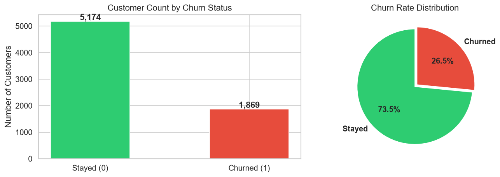
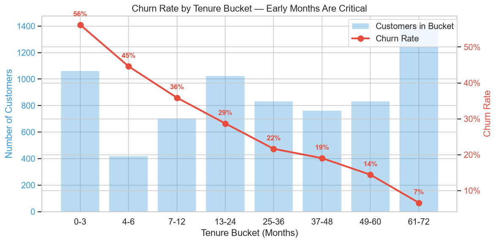
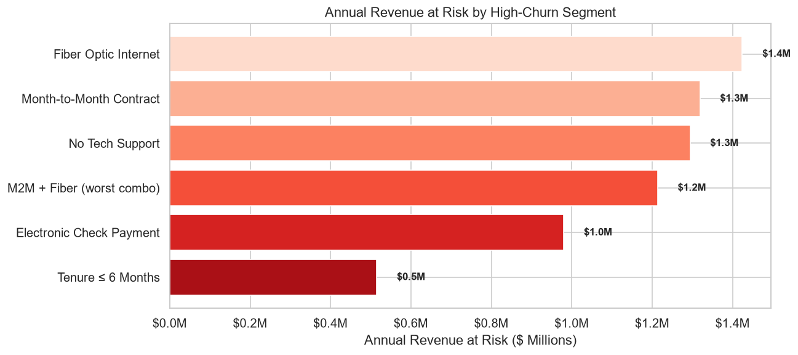

# 📊 Customer Churn Analysis — IBM Telco Dataset

Explored 7,043 IBM Telco customers, cleaned missing TotalCharges values, and found a baseline churn rate of ~26.5%.
Segmentation shows month-to-month contracts (43% churn) and electronic check payers (45%) as the riskiest segments.
Built logistic regression and XGBoost models (AUC ~0.85) identifying tenure, contract type, and charges as drivers.
Proposed a 20% discount plan for new month-to-month customers to switch to annual contracts, yielding 120–230% ROI.

---

## 📁 Project Structure

| File | Description |
|---|---|
| `Customer_Churn_Analysis.ipynb` | Complete end-to-end Jupyter notebook with analysis, visualizations & recommendations |
| `Telco_customer_churn.xlsx` | IBM Telco Customer Churn dataset (7,043 customers, 33 features) |
| `fig_01` – `fig_14` | Generated visualization charts (PNG) |

## 📋 Table of Contents (Notebook)

1. **Data Loading & Cleaning** — Handle missing `TotalCharges`, type conversions
2. **Exploratory Data Analysis** — Baseline churn rate (~26.5%), distributions, top churn reasons
3. **Cohort / Tenure-Based Retention Analysis** — Retention curves showing 47% churn in first 3 months
4. **Segmentation Analysis** — Churn by contract, payment method, internet service, add-ons
5. **Predictive Modelling** — Logistic Regression & XGBoost (AUC ~0.85), top driver rankings
6. **Revenue-at-Risk Estimation** — $15M+/year at risk from month-to-month segment alone
7. **Retention Plan with ROI** — 20% discount-to-convert strategy with 120–230% ROI
8. **Executive Summary & Recommendations** — Actionable findings for management

## 🔑 Key Findings

- **Onboarding failure**: ~47% of customers churn within the first 3 months
- **Month-to-month contracts** churn at 43% vs 3% for two-year contracts
- **Electronic check payers** churn at 45% — more than double any other payment method
- **Fiber optic customers** churn at 42% — signals a price–value gap
- **Missing add-on services** (tech support, online security) increase churn 2–3×

## 🛠️ Tech Stack

- Python (Pandas, NumPy, Scikit-learn, XGBoost)
- Matplotlib & Seaborn for visualization
- Jupyter Notebook

## 📊 Sample Visualizations

| Churn Distribution | Tenure Retention | Revenue at Risk |
|---|---|---|
|  |  |  |

## 🚀 How to Run

```bash
pip install pandas numpy matplotlib seaborn scikit-learn xgboost openpyxl
jupyter notebook Customer_Churn_Analysis.ipynb
```

## 📄 License

This project is for educational and analytical purposes.
